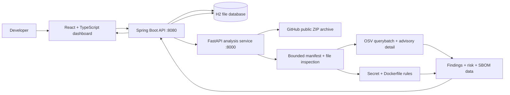

# TrustForge AI — Software Supply-Chain Security Platform

**Release:** `v1.1.0` · **Status:** Portfolio MVP · **Primary workflow:** public GitHub repository → dependency/security analysis → stored findings → CycloneDX SBOM + Markdown report.

TrustForge AI is a full-stack software supply-chain security platform. It inventories supported dependencies, enriches package/version matches with OSV advisories, detects selected secret-like patterns and Dockerfile risks, prioritizes findings, and exports security artifacts. It is designed to be evidence-first: findings retain advisory references, package/version context, and remediation guidance.

> **Scope honesty:** This release uses deterministic rules and live OSV advisory data. It does not run an LLM, execute repository code, authenticate to private repositories, or automatically modify dependencies. “AI” is the project name; the implemented analysis is explainable static analysis and vulnerability-data enrichment.

## What is implemented

### Repository analysis
- Register and scan public GitHub repositories through the dashboard or REST API.
- Download source as a bounded GitHub ZIP archive over HTTPS. Repository build scripts and application code are **never executed**.
- Inspect `package.json`, `package-lock.json`, Python `requirements.txt`, and Maven `pom.xml` manifests.
- Prefer lockfile-resolved npm versions over loose `package.json` ranges, independent of archive entry order.
- Bound repository archive inspection: 20 MB compressed, 50 MB uncompressed, 2,500 ZIP entries, 1 MB per file, and 500 dependencies.

### Vulnerability intelligence
- Query the OSV batch API for package + ecosystem + version matches.
- Hydrate abbreviated OSV query results from canonical advisory records when severity or detail is missing, with bounded concurrency and lookup limits.
- Normalize OSV severity labels and calculate CVSS v3.0/v3.1 base scores from complete vectors. CVSS v4 vectors are not guessed by the v3 calculator.
- Capture advisory/CVE aliases, CVSS score/vector, CWE IDs, published/modified timestamps, affected ranges, fixed versions, advisory references, and remediation suggestions when supplied by OSV.
- Preserve `UNKNOWN` when evidence is insufficient. Unknown severity contributes a small review-priority value and is never presented as safe.

### Additional static checks
- Selected high-signal credential patterns (AWS, GitHub, Google API, Slack, npm tokens, private-key headers, and generic credential assignments). Matched secret values are not emitted in evidence.
- Dockerfile checks for root execution, remote `ADD`, unpinned base images, and remote shell-pipe execution.
- Static rules are heuristics; validate findings before taking action.

### Risk, persistence, and exports
- Severity counts, a transparent heuristic risk score, risk band, points breakdown, and remediation suggestions.
- Local H2 persistence for repositories and scan history.
- Finding details and advisory references in the dashboard.
- CycloneDX 1.5 SBOM export with dependency components and dependency-vulnerability records where supported.
- Downloadable Markdown security report with summary, severity table, findings, CVSS details, fix guidance, references, and enrichment warnings.

## Architecture



The Spring Boot service owns project registration, scan orchestration, persistence, history, report and SBOM endpoints. FastAPI performs repository analysis and advisory enrichment. See [docs/ARCHITECTURE.md](docs/ARCHITECTURE.md) and [docs/SECURITY_MODEL.md](docs/SECURITY_MODEL.md).

## Tech stack

| Layer | Technology |
|---|---|
| Frontend | React 18, TypeScript, Vite, Lucide icons |
| Core API | Java 25, Spring Boot 3.5, Spring Data JPA |
| Analysis service | Python 3.9+, FastAPI, httpx |
| Persistence | H2 file database (local-first) |
| Advisory source | OSV API |
| SBOM format | CycloneDX 1.5 |
| CI | GitHub Actions (Python tests, Maven verify, frontend tests/build) |

## Requirements

- Java 25 (the Maven compiler is configured for release 25)
- Maven 3.9+
- Python 3.9+
- Node.js 20+
- Internet access for GitHub archive and OSV advisory lookups

## Run on macOS

Extract the ZIP and open the `TrustForge_AI_Final_MVP` folder in VS Code. Use three terminals and keep each service running in its own terminal.

### Terminal 1 — Analysis service

From the project root:

```bash
bash scripts/start-analysis.sh
```

The script checks that port 8000 is free, creates `ai-service/.venv` when needed, installs Python dependencies, and starts Uvicorn at `http://127.0.0.1:8000`.

### Terminal 2 — Spring Boot API

From the project root:

```bash
bash scripts/start-backend.sh
```

The script selects Java 25 when `/usr/libexec/java_home` is available, defaults the analysis URL to `http://127.0.0.1:8000`, and checks whether port 8080 is occupied before starting Maven. **Run only one backend process against the same H2 database.** Stop an existing backend with `Ctrl+C` before restarting; never delete `backend/data/trustforge.mv.db` to clear a lock.

### Terminal 3 — React dashboard

From the project root:

```bash
bash scripts/start-frontend.sh
```

Open the Vite URL shown in the terminal (normally `http://localhost:5173`; Vite uses another port if 5173 is already occupied).

### Register and scan a repository

Register a public GitHub repository:

```bash
curl -X POST http://localhost:8080/api/projects \
  -H "Content-Type: application/json" \
  -d '{"name":"Express","repositoryUrl":"https://github.com/expressjs/express"}'
```

Use the returned ID to scan:

```bash
curl -i -X POST http://localhost:8080/api/projects/1/scans
```

Review history and exports:

```bash
curl http://localhost:8080/api/scans
curl http://localhost:8080/api/scans/1
curl http://localhost:8080/api/scans/1/sbom
curl -OJ http://localhost:8080/api/scans/1/report
```

The API health checks are `GET http://localhost:8080/api/health` and `GET http://127.0.0.1:8000/health`. FastAPI interactive docs are available at `http://127.0.0.1:8000/docs`.

## Test and build

### Python analysis service

```bash
cd ai-service
python3 -m venv .venv
source .venv/bin/activate
pip install -r requirements.txt
python -m pytest -v
```

### Java API

```bash
cd backend
export JAVA_HOME=$(/usr/libexec/java_home -v 25)
export PATH="$JAVA_HOME/bin:$PATH"
mvn clean verify
```

### Frontend

```bash
cd frontend
npm install
npm test
npm run build
```

A combined local check is available as `bash scripts/verify.sh` from the project root. It creates/uses the Python virtual environment, installs Python and frontend dependencies, runs their tests/builds, and runs Maven verification. GitHub Actions runs the three checks independently on pushes and pull requests.

## REST API

| Method | Endpoint | Purpose |
|---|---|---|
| GET | `/api/health` | Spring API health |
| GET | `/api/projects` | List registered repositories |
| POST | `/api/projects` | Register public GitHub repository |
| DELETE | `/api/projects/{id}` | Remove repository (scan history retained) |
| POST | `/api/projects/{id}/scans` | Run and persist a scan |
| GET | `/api/scans` | Scan history |
| GET | `/api/scans/{id}` | Full scan result |
| GET | `/api/scans/{id}/sbom` | CycloneDX 1.5 JSON export |
| GET | `/api/scans/{id}/report` | Download Markdown security report |
| GET | `/health` | Python analysis health |
| POST | `/api/v1/scan` | Analyze a public GitHub repository |
| POST | `/api/v1/sbom` | Analyze and return CycloneDX SBOM |

## Security model and limitations

- **Public repositories only.** Private repository access, GitHub App installation/OAuth, GitHub webhooks, and organization tenancy are not implemented.
- **No repository code execution.** The analyzer downloads and inspects a ZIP archive; it does not run dependency install, build, test, or project scripts.
- **Bounded archive inspection.** The current implementation limits compressed archive size to 20 MB, total uncompressed content to 50 MB, ZIP entries to 2,500, individual files to 1 MB, directory depth, and dependencies to 500.
- **OSV data is live and can change.** A failed advisory lookup is reported as an enrichment warning, not as a clean bill of health. Missing severity remains `UNKNOWN`.
- **Risk is prioritization, not probability.** The risk score is a transparent heuristic based on finding severities. It is not a calibrated likelihood of compromise or business-impact model.
- **Static detectors are not exhaustive.** Secret patterns and Dockerfile checks can produce false positives and false negatives. They do not replace dedicated tools such as Gitleaks, Semgrep, Trivy, or a container runtime scanner.
- **No automatic remediation.** The product suggests upgrades and review steps but does not update manifests, open pull requests, or approve dependency changes.
- **Local MVP security.** Authentication, SSO, multi-user authorization, rate limiting, queue-backed scanning, isolated workers, PostgreSQL deployment hardening, and production observability are not included.
- The Java analysis client sends standard JSON and the `X-Repository-Url` compatibility header, using HTTP/1.1 to avoid unsupported HTTP/2 upgrade traffic with the local Uvicorn server.

## GitHub publication checklist

1. Create a public repository named `TrustForge-AI` (or your preferred project name).
2. Upload the contents of this project folder, not the ZIP file itself.
3. Confirm `.env`, virtual environments, `node_modules`, Maven `target`, and `backend/data` are not committed.
4. Add a dashboard screenshot and a short demo video after capturing them from your running local app.
5. Check the **Actions** tab and wait for all three CI jobs to pass. Do not claim CI success until it has run on your repository.
6. Add repository topics such as `software-supply-chain-security`, `sbom`, `osv`, `spring-boot`, `fastapi`, and `react`.
7. Pin the repository on your GitHub profile.

See [docs/GITHUB_RELEASE_CHECKLIST.md](docs/GITHUB_RELEASE_CHECKLIST.md) and [docs/RESUME_BULLETS.md](docs/RESUME_BULLETS.md).
