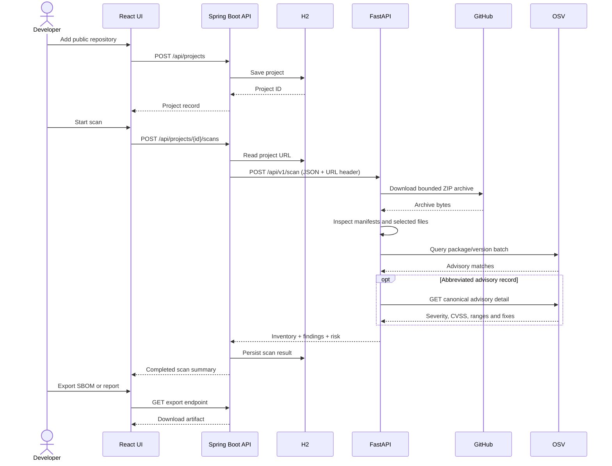

# Architecture and data flow

## Components

- **React + TypeScript dashboard:** repository registration, scan initiation, scan selection, finding exploration, severity/risk presentation, SBOM download, Markdown report download.
- **Spring Boot API:** validates and stores repository registrations, starts analysis calls, persists complete scan JSON in H2, lists history, and renders exports.
- **FastAPI analysis service:** downloads a public GitHub ZIP, extracts bounded files, inventories supported manifests, queries OSV, executes local static patterns, and returns findings plus inventory and risk metadata.
- **H2:** local file persistence at `backend/data/trustforge`.
- **External data:** GitHub ZIP archive endpoint and OSV API.

## Scan sequence

## Trust boundaries

1. The repository URL is restricted to `https://github.com/{owner}/{repo}`. Arbitrary host URLs are rejected by the parser.
2. GitHub archive contents are untrusted bytes. The analyzer does not extract the archive to disk or execute repository files.
3. File, archive, and dependency bounds limit resource use during static inspection.
4. OSV responses are external advisory data. The scanner retains source URLs and displays enrichment warnings on lookup failures.
5. Findings are advisory outputs for human review. The score is not an exploitability probability and no automatic remediation is performed.

## Persistence

The Spring API stores the raw analysis result JSON in a scan record, plus searchable summary fields (project ID, status, finding count, dependency count, risk score, and timestamp). This keeps the source result available to the detail and export endpoints without duplicating all nested finding fields into relational tables.

## Current constraints

The MVP uses synchronous requests and a local H2 file. A production deployment should add authenticated identities, organization-level authorization, queue-backed scan jobs, per-job isolated workers, persistent PostgreSQL, request throttling, audit logging, metrics, and a retention policy.
